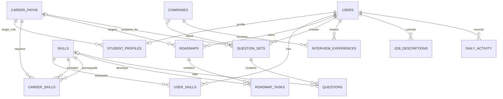

# Career Compass database

The persistence layer uses Spring Data JPA and PostgreSQL. Hibernate updates the existing schema with `ddl-auto=update`; this setting does not drop application tables. The current Supabase schema has not been live-verified from this environment.

## Repository startup diagnosis

The repository initialization failure was caused by `StudentProfile` marking its `User` relationship itself as `@Id` while using `@MapsId`. Spring Data's `JpaMetamodelEntityInformation` treated the profile as requiring an `IdClass`, which the entity did not define. The mapping now has an explicit `Long id` stored in `user_id`, with the `User` relationship sharing that key through `@MapsId`. The H2-backed application context test now initializes all 14 repositories successfully.

## Entities and fields

`Long` primary keys use PostgreSQL identity generation except `StudentProfile`, whose `user` is both its primary key and a foreign key to `users.id`.

| Entity / table | Fields (Java types) |
|---|---|
| `User` / `users` | `id: Long`, `name: String`, `email: String`, `passwordHash: String`, `createdAt: LocalDateTime` |
| `StudentProfile` / `student_profiles` | `user: User` (PK/FK), `branch: String`, `graduationYear: Integer`, `currentYear: Integer`, `dailyAvailableHours: Integer`, `targetRole: CareerPath`, `careerGoal: String` |
| `CareerPath` / `career_paths` | `id: Long`, `name: String`, `description: String`, `difficulty: String`, `averagePreparationMonths: Integer` |
| `Skill` / `skills` | `id: Long`, `name: String`, `category: String`, `description: String`, `difficulty: String` |
| `CareerSkill` / `career_skills` | `id: Long`, `careerPath: CareerPath`, `skill: Skill`, `importance: Integer`, `requiredLevel: Integer`, `prerequisiteSkill: Skill` (optional) |
| `UserSkill` / `user_skills` | `id: Long`, `user: User`, `skill: Skill`, `proficiency: Integer`, `lastUpdated: LocalDateTime` |
| `Roadmap` / `roadmaps` | `id: Long`, `user: User`, `careerPath: CareerPath`, `title: String`, `createdAt: LocalDateTime`, `targetDeadline: LocalDate`, `status: RoadmapStatus` |
| `RoadmapTask` / `roadmap_tasks` | `id: Long`, `roadmap: Roadmap`, `skill: Skill` (optional), `title: String`, `description: String`, `weekNumber: Integer`, `estimatedHours: Integer`, `resourceUrl: String`, `status: RoadmapTaskStatus` |
| `Company` / `companies` | `id: Long`, `name: String`, `description: String`, `website: String`, `industry: String` |
| `QuestionSet` / `question_sets` | `id: Long`, `title: String`, `company: Company` (optional), `careerPath: CareerPath` (optional), `branch: String`, `batch: String`, `difficulty: String`, `createdBy: User` |
| `Question` / `questions` | `id: Long`, `questionSet: QuestionSet`, `skill: Skill` (optional), `questionText: String`, `answer: String`, `difficulty: String`, `questionType: QuestionType` |
| `InterviewExperience` / `interview_experiences` | `id: Long`, `user: User`, `company: Company`, `role: String`, `batch: String`, `experienceText: String`, `interviewDate: LocalDate`, `difficulty: String` |
| `JobDescription` / `job_descriptions` | `id: Long`, `user: User`, `companyName: String`, `role: String`, `description: String`, `createdAt: LocalDateTime` |
| `DailyActivity` / `daily_activity` | `id: Long`, `user: User`, `activityDate: LocalDate`, `activityType: String` |

## Relationships

Relationships use lazy loading and do not cascade deletes. `CareerSkill` and `UserSkill` are explicit join entities because they carry attributes and uniqueness rules. `QuestionType`, `RoadmapStatus` (`ACTIVE`, `COMPLETED`, `PAUSED`, `ARCHIVED`), and `RoadmapTaskStatus` (`NOT_STARTED`, `IN_PROGRESS`, `COMPLETED`, `SKIPPED`) are persisted by enum name using `EnumType.STRING`.



## Constraints and indexes

- `users.email`, `career_paths.name`, `skills.name`, and `companies.name` are unique and required.
- `career_skills(career_path_id, skill_id)`, `user_skills(user_id, skill_id)`, and `daily_activity(user_id, activity_date, activity_type)` have named unique constraints.
- User skill proficiency and career-skill importance/required level have validation bounds from 0–5 and 1–5 respectively.
- Foreign keys are declared through `@JoinColumn`; common lookup foreign keys and status/filter columns are indexed.
- Required text fields and relation keys use non-null columns; optional question-set links and question skill tags may be null.

JPA `@Entity`/`@Table` map classes to tables; `@Id` and `@GeneratedValue(IDENTITY)` define generated keys; `@ManyToOne`, `@OneToOne`, `@MapsId`, and `@JoinColumn` define the relationships; `@UniqueConstraint` and `@Index` declare schema-level rules; validation annotations validate values when validation is invoked; Hibernate timestamp annotations manage selected creation/update timestamps.

## Configuration

Set these values in the process environment or deployment secret manager. `DB_HOST` is the Supabase Session Pooler host only (no protocol or port); `DB_USERNAME` is the pooler-specific database username from Supabase; `DB_PASSWORD` is the database password. Do not put credentials in this document or source control.

The datasource URL is `jdbc:postgresql://${DB_HOST}:5432/postgres?sslmode=require`; it requires TLS. The JDBC driver is `org.postgresql:postgresql`. This project does not include MySQL dependencies. No credential values are configured in the checked environment, so Supabase host and username cannot be independently checked here.

Run the application from the project root:

```bash
export DB_HOST='<your-session-pooler-host>'
export DB_USERNAME='<your-session-pooler-username>'
export DB_PASSWORD='<your-database-password>'
./mvnw clean compile
./mvnw test
./mvnw spring-boot:run
```

The Maven test suite uses an isolated H2 in-memory database in PostgreSQL compatibility mode. It does not create or modify Supabase tables. It verifies repository initialization, 14 mapped tables, the three named duplicate-protection constraints, seed counts, and unchanged counts after rerunning the initializer. To inspect the live schema, start the application with valid environment values, then use Supabase Dashboard → SQL Editor and run:

```sql
select table_name
from information_schema.tables
where table_schema = 'public' and table_type = 'BASE TABLE'
order by table_name;

select conrelid::regclass as table_name, conname, contype
from pg_constraint
where connamespace = 'public'::regnamespace
order by conrelid::regclass::text, conname;
```

After startup, Hibernate should create/update the mapped tables and the initializer should insert career paths, skills, and their mappings. The initializer checks existing names and pair relationships before inserting, so ordinary restarts do not duplicate catalogue records. No students, companies, or interview experiences are seeded.
